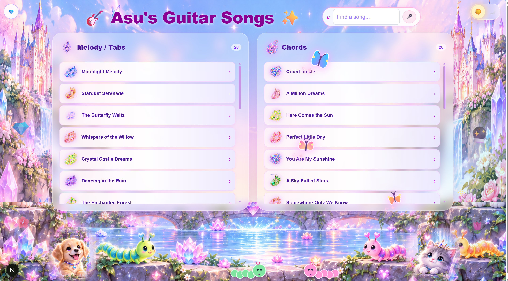
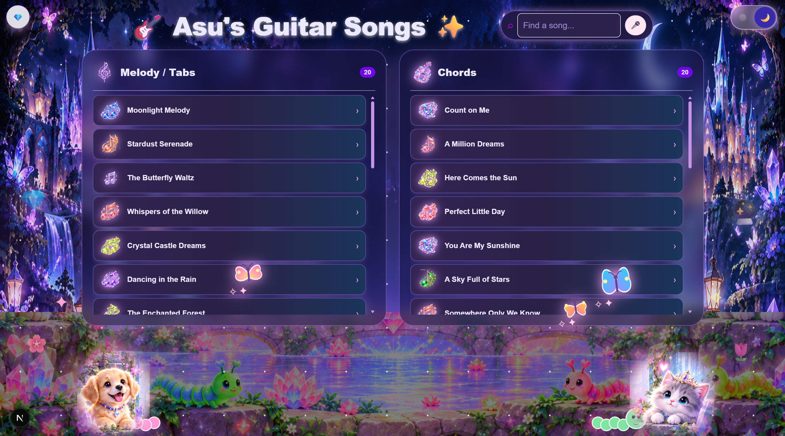
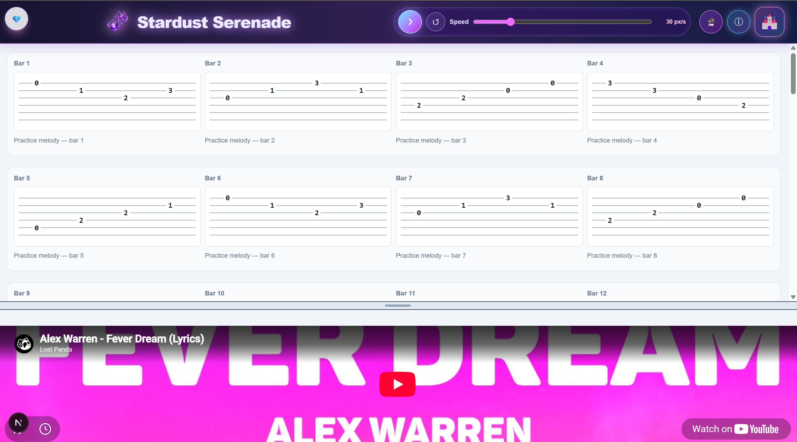
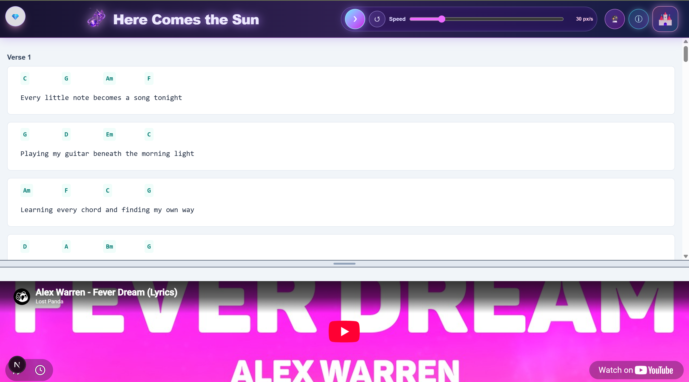
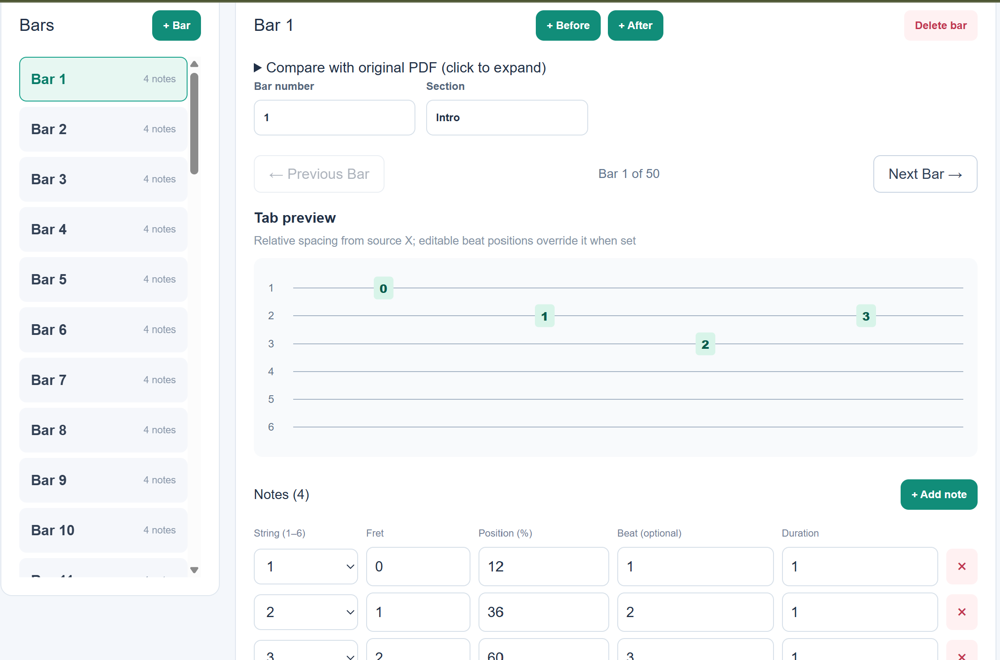
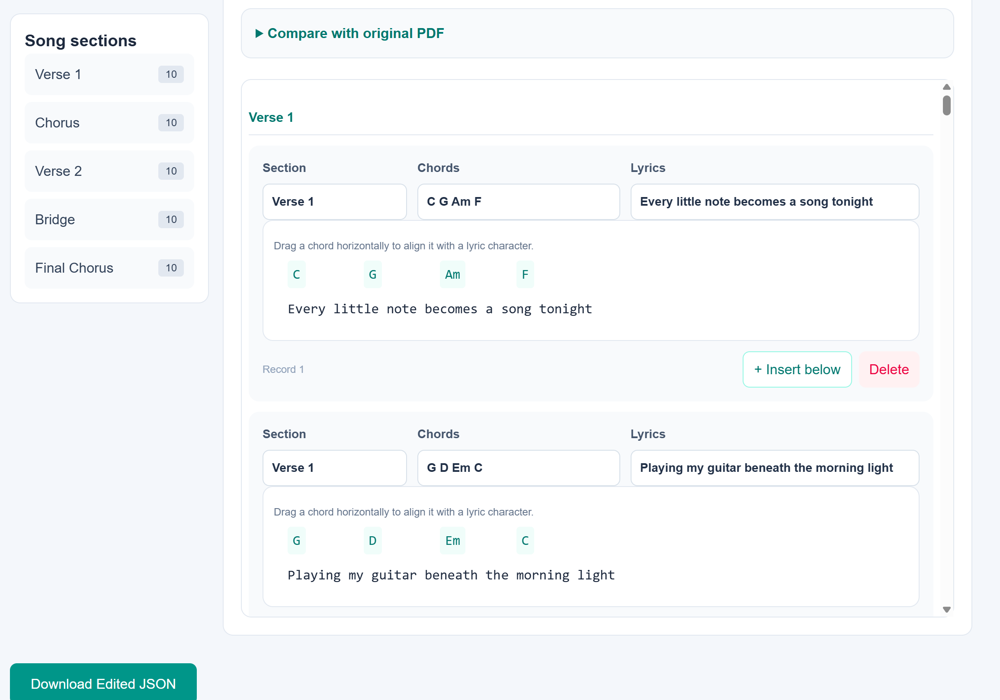
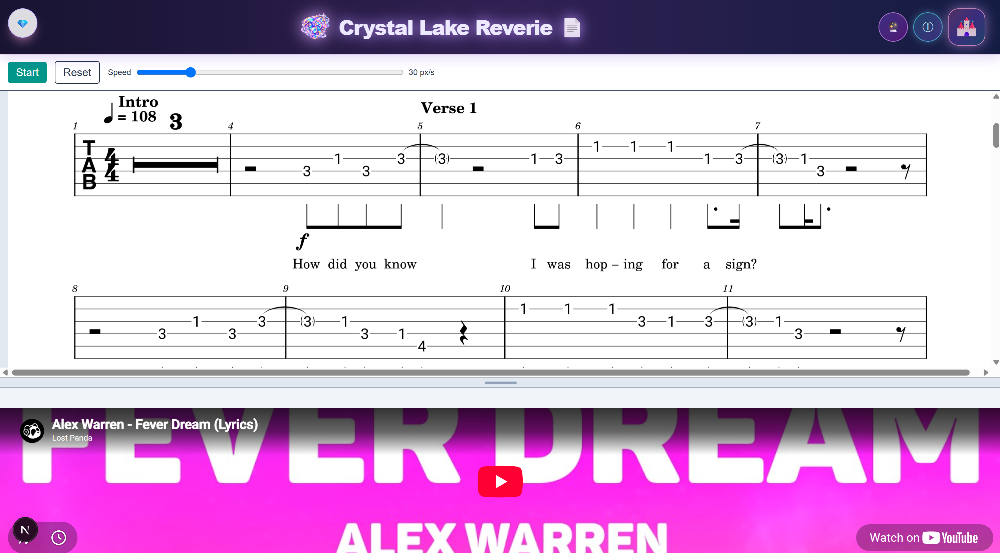

# 🎸 Asu Guitar Lab ✨

### A Magical Guitar Practice Companion

**Asu Guitar Lab** is an offline-first guitar learning and practice application built with Next.js, React, TypeScript, Electron, and SQLite.

Designed to make practicing guitar more enjoyable, it combines interactive guitar tablature, chords and lyrics, PDF viewing, automatic scrolling, and YouTube practice videos in a magical, crystal-inspired environment.

Created with love for a young guitarist. 💖🦋

---

## 🏰 Magical Guitar Kingdom

Explore your music collection in two enchanting themes: **Sweet Crystal Kingdom** and **Midnight Magic**.

The homepage features crystal castles, glowing musical icons, animated butterflies, playful animals, and independently scrollable song collections.

### ☀️ Sweet Crystal Kingdom



### 🌙 Midnight Magic



---

## ✨ Features

### 🎼 Melody & Guitar Tabs

- Guitar tablature organized into individual bars
- Six-string guitar visualization
- Automatic scrolling with Play, Pause, and Reset
- Adjustable scrolling speed
- Interactive note editing, including fret and string positioning
- Lyrics and section annotations



### 🎶 Chords & Lyrics

- Chord sheets with lyrics
- Editable chord positioning
- Chord and lyric alignment
- Practice scrolling
- Original PDF comparison where available



### ✏️ Interactive Music Editing

Correct extracted music and customize songs using dedicated editors.

**Melody Editor**

- Add, delete, and rearrange bars
- Edit fret numbers and string positions
- Drag notes visually
- Edit lyrics, sections, and note properties



**Chord Editor**

- Edit lyrics and chord progressions
- Adjust chord positions
- Insert and remove chord lines
- Organize song sections



### 📄 PDF-Only Practice

Not every song requires extraction. Original PDF files can also be used directly for practice.



### 🎬 YouTube Practice Companion

- Embedded YouTube videos
- Show or hide the video panel
- Resizable video area
- Practice while viewing the original song video

### 🦋 Magical Interactions

- Animated butterflies
- Playful puppy and kitten
- Crawling caterpillars
- Glowing crystals and musical notes
- Randomized song icons
- Light and dark magical themes

---

## 💻 Web Demo vs. Desktop Application

Asu Guitar Lab supports two different experiences.

| Feature | Web Demo | Windows Desktop |
|---|---|---|
| Magical themes | ✅ | ✅ |
| Sample songs | ✅ | — |
| Personal song library | — | ✅ |
| Melody and chord practice | ✅ | ✅ |
| Automatic scrolling | ✅ | ✅ |
| PDF viewing | ✅ | ✅ |
| Local SQLite database | — | ✅ |
| Save and edit personal songs | — | ✅ |
| Browser voice search | Supported browsers | Hidden |
| YouTube videos | Internet required | Internet required |

**Web Demo:** Explore the interface and practice with demonstration songs.

**Desktop Application:** Maintain your personal music library, store original PDFs locally, and practice without needing a cloud database.

YouTube playback still requires internet access.

---

## 🛠️ Tech Stack

| Technology | Purpose |
|---|---|
| Next.js 15 | Application framework |
| React 19 | User interface |
| TypeScript | Type-safe development |
| Tailwind CSS 4 | Styling and themes |
| Electron | Windows desktop application |
| SQLite | Local persistent database |
| PDF.js | PDF rendering and extraction |
| YouTube Embeds | Video practice |

---

## 🚀 Getting Started

### Prerequisites

- Node.js
- npm

### Clone the Repository

```bash
git clone <YOUR_REPOSITORY_URL>
cd asuguitar
```

Replace `<YOUR_REPOSITORY_URL>` with the actual repository URL.

### Install Dependencies

```bash
npm install
```

### Run the Browser Demo

```bash
npm run dev
```

Open http://localhost:3000.

### Run the Electron Desktop Application

Build the Next.js static export:

```bash
npm run build
```

Start Electron:

```bash
npx electron .
```

The desktop application uses local SQLite storage for the personal song library.

A Windows installer can be created through a separate packaging configuration.

---

## 🔒 Data & Privacy

The desktop application is designed to store personal songs, practice data, and uploaded PDFs locally on the user's computer.

The public demo uses demonstration content and does not provide access to the private desktop song library.

The application may connect to external services when playing YouTube videos.

---

## 💖 Why Asu Guitar Lab?

Learning an instrument takes practice, creativity, and patience.

Asu Guitar Lab was created to bring guitar lessons, practice material, and musical inspiration together in one friendly place.

The goal is simple: **make every practice session feel a little more magical.**

---

## 👩‍💻 Author

**Anupama Rajendra**

Software Engineer | Full-Stack Web & Mobile Developer

🌐 **Portfolio:** [Anupama's Portfolio](https://a-nu-1.github.io/anupamaportfolio/)

---

### 💎 Keep Practicing, Keep Dreaming, Keep Making Music! 🎸✨